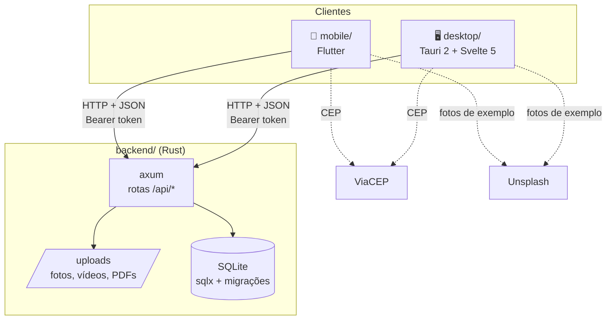

# Arquitetura



## Por que assim
- **Uma API para os dois apps:** quem usa o celular encontra quem usa o computador.
- **Rust no backend:** é a mesma linguagem da casca do Tauri, e o axum é leve.
- **SQLite:** é simples para as aulas, um arquivo só. Para 20 a 50 mil acessos, a troca natural é PostgreSQL, que o sqlx também suporta (ver [[Decisoes-e-Limitacoes]]).
- **Tauri:** a parte Rust do desktop só abre a janela. A interface é Svelte e fala direto com a API.

## Pastas
```
backend/
  migrations/        0001 (base), 0002 (eventos), 0003 (carteira, serviços, loja)
  src/
    main.rs          servidor, CORS, uploads
    auth.rs          tokens e Argon2
    rules.rs         regras puras e testadas (CPF, distância, vacinas)
    demo.rs          dados de exemplo
    routes/          users, dogs, feed, discover, events, services, places, moderation
mobile/lib/          main.dart (tema), api.dart, models.dart, widgets.dart, screens/
desktop/src/         App.svelte, app.css (tema), lib/, pages/
desktop/src-tauri/   casca nativa
docs/wiki/           esta documentação (vault do Obsidian)
```

Ver [[API]], [[Banco-de-Dados]], [[App-Mobile]] e [[App-Desktop]].
