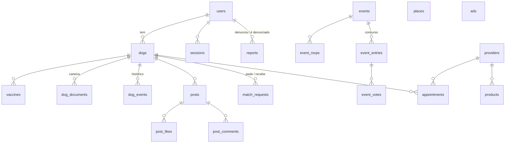

# Banco de dados

SQLite com migrações em `backend/migrations/`, que rodam sozinhas ao iniciar a API.

| Tabela | Para que serve |
|---|---|
| `users` | Donos e administradores. CPF único, bloqueio (`banned_at`), exclusão (`deleted_at`) |
| `sessions` | Tokens de login |
| `dogs` | Perfil e carteira (peso, cor, atividade, procura, microchip, castração...). `removed_at` mantém o histórico |
| `vaccines` | Aplicação e reforço |
| `dog_documents` | Pedigree, exames, RG... (`status`: enviado, verificado, recusado) |
| `dog_events` | Histórico do cão |
| `posts`, `post_likes`, `post_comments` | Feed (`media_type`: image ou video) |
| `match_requests` | `passed`, `pending`, `accepted` ou `rejected` |
| `events`, `event_rsvps`, `event_entries`, `event_votes` | Eventos, presença, concurso e votos (um por pessoa) |
| `providers`, `appointments`, `products` | Serviços, agendamentos e loja |
| `places` | Parques e pontos de encontro |
| `reports` | Denúncias (`aberta`, `procedente` ou `improcedente`) |
| `ads` | Anúncios de patrocinadores |
