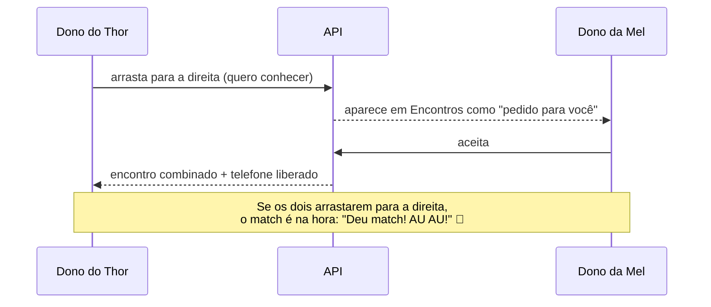

# Descobrir e match

Estilo Tinder: cartões de cães por perto, **500 m** por padrão, com opção de 1 km ou 3 km.

## Fluxo

## Cartão
- **Dados:** foto, nome em letras gigantes, idade, raça, sexo, distância aproximada e dono (só o primeiro nome).
- **Selos:** temperamento, "Pode morder", "No cio", "Vacinas em dia", nível de atividade, o que procura e "Pedigree".
- **Gostos:** "AMA" e "ODEIA".
- **Como responder:** arraste o cartão, use os botões **Passa / Quero!** ou, no desktop, as setas ← e → do teclado.

## Modos
| Modo | Quem aparece |
|---|---|
| Amizade | Todos os cães por perto com vacinação em dia |
| Cruzamento | Só cães do **sexo oposto**, **não castrados**, que também procuram cruzamento. O seu cão também precisa estar marcado assim |

## Match
- **Comemoração:** tela cheia com confete azul e amarelo e o latido **"au au"**. No desktop o som é sintetizado com a Web Audio API; no mobile é o arquivo `assets/sounds/au_au.wav`.
- **Contato:** o telefone e o WhatsApp do outro dono só aparecem em **Encontros**, depois do aceite.

Regras completas em [[Regras-de-Negocio]].
