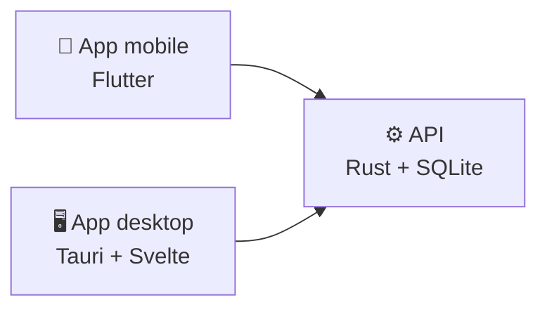

# Visão geral

## O cliente
Empreendedor leigo em tecnologia, que quer lançar o **All Love**: um aplicativo para os donos cadastrarem seus pets, os cães fazerem novas amizades (ou "pro criar") e os donos se encontrarem com segurança. Quem usa o app são os **donos**.

## O que foi pedido na entrevista

| Pedido | Onde está |
|---|---|
| Cadastro simples, mas seguro (telefone, CPF, onde mora) | [[Cadastro-e-Seguranca]] |
| Informações do cão: raça, idade, cio, gostos, se morde, se é agressivo | [[Caes-e-Carteira-Digital]] |
| Rolar fotos e curtir | [[Feed]] |
| Cães a 500 m, arrastar para o lado, o outro aceita ou não | [[Descobrir-e-Match]] |
| Parques e pontos de encontro próximos (5) | [[Parques]] |
| Vacinas em dia, senão bloqueia | [[Regras-de-Negocio]] |
| Denúncia e bloqueio permanente | [[Moderacao]] |
| Histórico do cão e dos cães que o dono já teve | [[Caes-e-Carteira-Digital]] |
| Versão grátis com anúncios e premium sem anúncios | [[Anuncios-e-Premium]] |
| Celular e tablet | [[App-Mobile]] |
| Azul fraquinho e branco | [[Design]] |
| De 20 a 50 mil acessos e prazo de 3 a 5 meses | [[Decisoes-e-Limitacoes]] |

## O que veio depois
- **Eventos** malucos (desfile de cadelas, corrida de salsichas...): ver [[Eventos]].
- **Documento de funcionalidades** do grupo: carteira digital, pedigree, serviços com agendamento, loja, vídeos e comentários. O que conflitava com a entrevista ficou de fora (ver [[Decisoes-e-Limitacoes]]).
- **Visual Material 3 Expressive** com as cores que o cachorro enxerga: ver [[Design]].

## Três partes

Detalhes em [[Arquitetura]].
